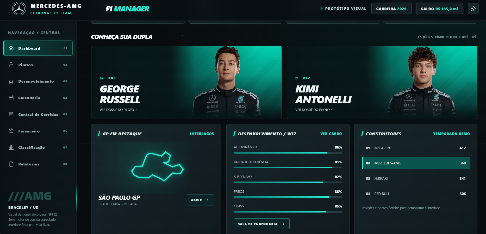
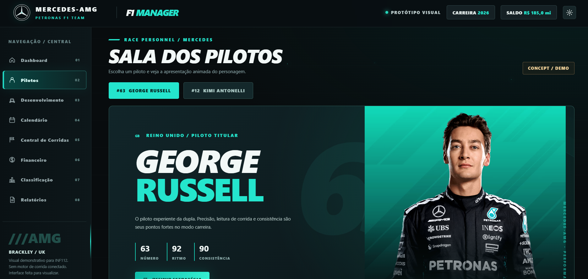
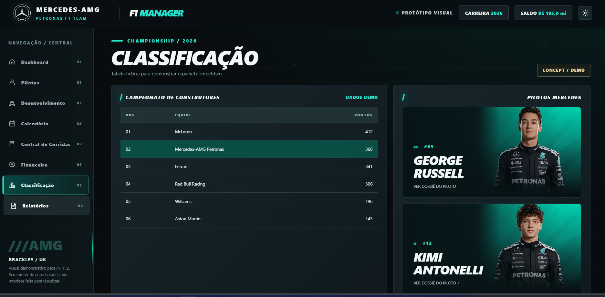
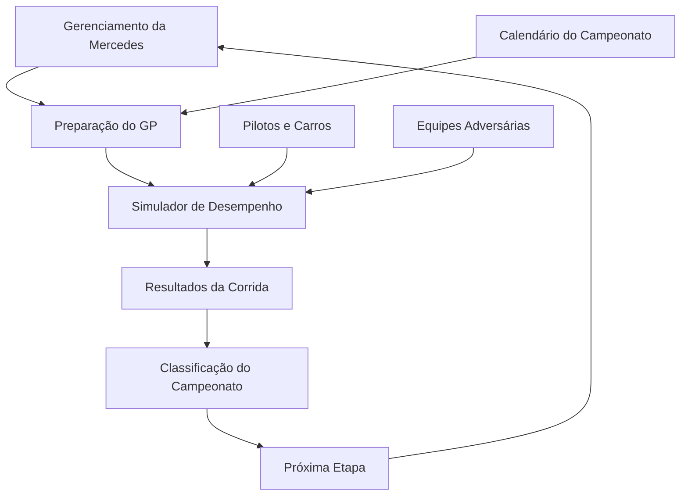
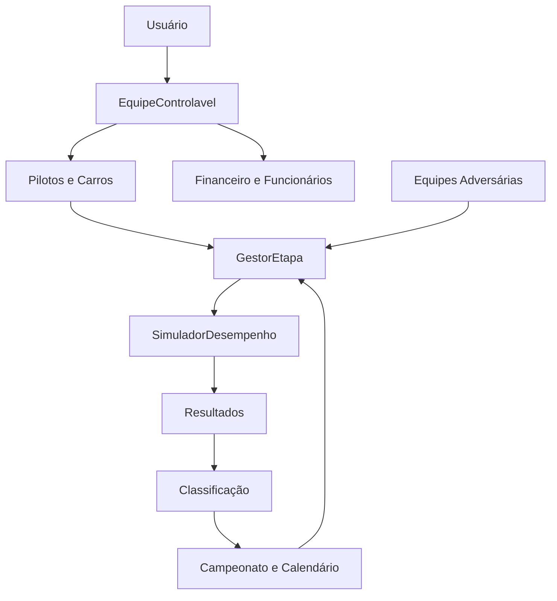

<div align="center">

# 🏎️ F1 MANAGER

### MERCEDES-AMG PETRONAS
**SISTEMA DE GERENCIAMENTO E SIMULAÇÃO DE FÓRMULA 1**

**Engenharia • Estratégia • Gestão • Desempenho**

*Gerencie a equipe. Desenvolva o carro. Simule a temporada. Analise cada decisão.*

<p>
  
  
  
  
</p>

**[Visão geral](#-visão-geral) · [Interface](#-interface-visual) · [Funcionalidades](#-funcionalidades) · [Simulação](#-simulador-de-desempenho) · [Instalação](#-como-executar) · [Arquitetura](#-arquitetura-e-diagrama-de-classes) · [Equipe](#-equipe-de-desenvolvimento)**

---

</div>

## ✨ Visão geral

O **F1 Manager** é um sistema acadêmico desenvolvido em **C++17**, voltado ao gerenciamento da **Mercedes-AMG PETRONAS Formula One Team**, com um simulador de desempenho integrado às decisões administrativas, técnicas e estratégicas da equipe.

O projeto foi desenvolvido para a disciplina de **Programação II**, do curso de **Ciência da Computação da Universidade Federal de Viçosa (UFV)**.

A proposta combina três elementos principais:

- 🏢 **Gerenciamento:** administração financeira, pilotos, funcionários, contratos e desenvolvimento dos carros.
- 📅 **Calendário:** organização e acompanhamento das etapas de uma temporada de Fórmula 1.
- 🏁 **Simulação:** realização de corridas com resultados influenciados pelas características dos pilotos, carros, circuitos e decisões da equipe.

> [!IMPORTANT]
> A **Mercedes é a única equipe controlável**. As demais equipes participam do campeonato como adversárias gerenciadas automaticamente.

<div align="center">

| 🏎️ Equipes | 👤 Pilotos | 🏁 Grandes Prêmios | 📅 Temporada |
|:---:|:---:|:---:|:---:|
| **11** | **22** | **24** | **2026** |

</div>

> O calendário e os parâmetros atuais incluem valores fictícios para fins de simulação acadêmica. Nesta versão, os GPs utilizam 20 voltas, não reproduzindo integralmente o regulamento oficial da Fórmula 1.

---

## 📸 Interface visual

O projeto também possui um protótipo de interface gráfica inspirado na identidade visual da Mercedes-AMG PETRONAS, utilizando **tons escuros, verde-petróleo e elementos modernos de visualização**.

<div align="center">

### 🖥️ Painel de controle



*Visão geral do sistema, apresentando a equipe, os pilotos e indicadores de gerenciamento.*

<br>

### 🏎️ Sala dos Pilotos



*Apresentação dos pilotos da Mercedes, George Russell e Kimi Antonelli.*

<br>

### 🏆 Classificação do Campeonato



*Visualização da classificação de construtores e informações dos pilotos.*

</div>

> [!NOTE]
> Essas capturas representam o **protótipo gráfico**, ainda separado do motor funcional de gerenciamento e simulação. Os dados exibidos na interface são demonstrativos. A versão funcional do sistema é executada pelo terminal.

---

## ⚙️ Funcionalidades

O sistema está estruturado em diferentes módulos que trabalham de maneira integrada.

### 🏢 Gerenciamento da Mercedes

Permite administrar os principais recursos e elementos relacionados à equipe.

| Funcionalidade | Descrição |
|---|---|
| 👤 **Pilotos** | Consulta e gerenciamento dos pilotos da equipe |
| 📑 **Contratos** | Controle de informações contratuais |
| 👥 **Funcionários** | Gerenciamento de engenheiros, mecânicos e outros profissionais |
| 💰 **Finanças** | Controle de orçamento, despesas e transações |
| 🔧 **Manutenção** | Recuperação das condições dos componentes |
| ⚙️ **Desenvolvimento** | Melhorias técnicas nos carros |
| 📊 **Planejamento** | Preparação e acompanhamento da equipe ao longo do campeonato |

### 🏁 Campeonato de Fórmula 1

O sistema permite acompanhar uma temporada simulada com 11 equipes e 22 pilotos.

Entre suas funcionalidades estão:

- Calendário de 24 Grandes Prêmios.
- Consulta à próxima corrida.
- Simulação das etapas.
- Registro e consulta dos resultados.
- Pontuação de pilotos e construtores.
- Atualização da classificação.
- Avanço progressivo da temporada.

### 📊 Análise de desempenho

As decisões realizadas no gerenciamento influenciam o funcionamento do simulador.

A proposta é relacionar investimentos, melhorias, características dos pilotos e condições dos carros aos resultados obtidos nas corridas.

---

## 🧠 Simulador de desempenho

O **Simulador de Desempenho** é o componente central do F1 Manager.

Seu objetivo é representar o desempenho competitivo dos pilotos e das equipes por meio de cálculos e eventos probabilísticos, considerando as características de cada corrida.

### ⚡ Fatores considerados

| Fator | Influência no simulador |
|---|---|
| 👤 **Piloto** | Habilidade e consistência |
| 🏎️ **Carro** | Desempenho e condição dos componentes |
| ⚙️ **Engenharia** | Melhorias técnicas realizadas |
| 🌦️ **Clima** | Condições que afetam o desempenho |
| 🏁 **Circuito** | Características técnicas da pista |
| 👥 **Equipe** | Funcionários e decisões estratégicas |
| ⛽ **Combustível** | Consumo durante a corrida |
| ⚠️ **Eventos** | Falhas, acidentes e variações de desempenho |

### 🔄 Funcionamento geral



A lógica atual constitui uma aproximação didática, que será aprimorada conforme o desenvolvimento do projeto.

### 📅 Calendário de corridas

O calendário organiza as etapas do campeonato e permite acompanhar a progressão da temporada.

Cada corrida está associada a informações como circuito, condições de disputa e posição no calendário.

O sistema relaciona o avanço do campeonato às atividades de gerenciamento, permitindo que a Mercedes realize decisões entre as corridas.

---

## 🚀 Como executar

O sistema funcional pode ser compilado e executado no **Ubuntu ou WSL**, utilizando GNU Make e g++.

### 1. Pré-requisitos

Instale as ferramentas necessárias:

```bash
sudo apt update
sudo apt install build-essential make
```

### 2. Acesse a pasta do projeto

A partir da raiz do repositório:

```bash
cd F1-MANAGER
```

### 3. Compile o sistema

```bash
make
```

### 4. Execute o programa

```bash
make run
```

### 5. Execute os testes

```bash
make test
```

### 🛠️ Comandos do Makefile

| Comando | Descrição |
|---|---|
| `make` | Compila o sistema Mercedes |
| `make run` | Executa a aplicação |
| `make test` | Compila e executa os testes automatizados |
| `make tools` | Compila ferramentas auxiliares, quando disponíveis |
| `make clean` | Remove arquivos gerados pela compilação |
| `make STRICT=1` | Ativa `-Werror` para tratar avisos como erros |
| `make -j4` | Utiliza até quatro tarefas simultâneas de compilação |

O executável principal é gerado em:

```text
F1-MANAGER/bin/f1_manager
```

> [!NOTE]
> A versão funcional em terminal não depende de SFML ou Dear ImGui. Essas bibliotecas são utilizadas no protótipo visual, desenvolvido separadamente.

---

## 🧩 Arquitetura e diagrama de classes

O projeto foi organizado seguindo os conceitos de **Programação Orientada a Objetos (POO)**, buscando modularização, reutilização de código, encapsulamento e separação de responsabilidades.

Entre os principais conceitos utilizados estão:

- **Encapsulamento:** proteção e organização dos atributos e métodos.
- **Herança:** especialização das classes de equipes e funcionários.
- **Polimorfismo:** utilização de comportamentos específicos a partir de interfaces compartilhadas.
- **Composição:** relacionamento entre entidades, como pilotos, carros e equipes.
- **Modularização:** separação das implementações em arquivos `.hpp` e `.cpp`.

### 📐 Diagrama de classes UML

<div align="center">

<a href="F1-MANAGER/docs/Diagrama_De_Classes-F1.svg">
  
</a>

**Diagrama de classes do sistema F1 Manager**

<sub>Clique na imagem para abrir o diagrama original em formato vetorial.</sub>

</div>

> O diagrama representa uma versão de referência da arquitetura. Alguns módulos desenvolvidos posteriormente poderão ser incorporados à versão final do UML.

### 🔗 Organização dos módulos



### 📂 Estrutura do repositório

```text
20262-team-5/
├── README.md
│
└── F1-MANAGER/
    ├── Makefile
    ├── README.md
    │
    ├── assets/
    │   └── images/
    │       ├── dashboard.png
    │       ├── sala-dos-pilotos.png
    │       └── classificacao.png
    │
    ├── docs/
    │   ├── Diagrama_De_Classes-F1.svg
    │   └── diagrama-de-classes.png
    │
    ├── data/
    │
    ├── include/
    │   ├── Campeonato.hpp
    │   ├── GestorEtapa.hpp
    │   ├── SimuladorDesempenho.hpp
    │   ├── EquipeControlavel.hpp
    │   ├── EquipeAdversaria.hpp
    │   └── ...
    │
    ├── src/
    │   ├── main_headless.cpp
    │   ├── Campeonato.cpp
    │   ├── GestorEtapa.cpp
    │   ├── SimuladorDesempenho.cpp
    │   ├── ui/
    │   └── ...
    │
    ├── tests/
    │   └── teste_*.cpp
    │
    ├── build/
    └── bin/
```

| Diretório | Finalidade |
|---|---|
| `assets/` | Recursos visuais utilizados pelo projeto |
| `docs/` | Diagramas e documentação técnica |
| `data/` | Arquivos de dados locais |
| `include/` | Declarações das classes |
| `src/` | Implementações do sistema |
| `src/ui/` | Protótipo da interface gráfica |
| `tests/` | Testes automatizados |
| `build/` | Arquivos intermediários de compilação |
| `bin/` | Executáveis gerados |

---

## 💻 Tecnologias utilizadas

| Tecnologia | Aplicação |
|---|---|
| **C++17** | Linguagem principal |
| **GNU Make** | Automação da compilação |
| **g++** | Compilador C++ |
| **SFML 3** | Recursos gráficos do protótipo |
| **Dear ImGui** | Componentes da interface |
| **ImGui-SFML** | Integração entre ImGui e SFML |
| **Git** | Controle de versão |
| **GitHub** | Hospedagem e colaboração |
| **Ubuntu / WSL** | Ambiente de desenvolvimento e testes |

---

## 🧪 Testes automatizados

O projeto possui testes para verificar as principais funcionalidades do sistema.

As áreas contempladas incluem:

- Campeonato e progressão de etapas.
- Simulação de corridas.
- Gerenciamento da Mercedes.
- Equipes e funcionários.
- Financeiro e transações.
- Manutenção e desgaste.
- Resultados e pontuação.

Para executar os testes:

```bash
cd F1-MANAGER
make test
```

O Makefile separa o ponto de entrada da aplicação dos executáveis de teste, evitando conflitos entre diferentes funções `main()`.

---

## 📈 Status do desenvolvimento

| Módulo | Situação |
|---|---|
| Gerenciamento da Mercedes | ✅ Funcional no terminal |
| Gerenciamento financeiro | ✅ Implementado |
| Funcionários e contratos | ✅ Implementados |
| Desenvolvimento e manutenção | ✅ Implementados |
| Campeonato e calendário | ✅ Implementados |
| Simulador de desempenho | ✅ Funcional, com simplificações |
| Makefile | ✅ Implementado |
| Testes automatizados | ✅ Disponíveis |
| Interface SFML / ImGui | 🟡 Protótipo demonstrativo |
| Estatísticas históricas de 2022–2025 | 🛠️ Planejadas para integração |
| Integração da interface gráfica | ⏳ Pendente |
| Salvamento completo de partidas | ⏳ Pendente |

### 🔮 Próximas melhorias

O desenvolvimento seguirá concentrado na evolução do simulador e em sua integração com o gerenciamento da Mercedes.

As próximas etapas previstas incluem:

1. Utilização de dados históricos de Fórmula 1 armazenados localmente.
2. Calibração estatística dos pilotos e equipes.
3. Aprimoramento do desempenho por circuito.
4. Evolução das estratégias e eventos de corrida.
5. Geração de relatórios para apoiar decisões.
6. Integração futura da interface gráfica ao motor funcional.

O sistema foi planejado para funcionar **sem necessidade de APIs externas durante sua execução**.

---

## 👥 Equipe de desenvolvimento

| Integrante | Matrícula |
|---|---|
| **Kelvyn Caetano** | 124691 |
| **Pedro** | 124670 |
| **Pedro Henrique** | 124667 |
| **Gabriel** | 124671 |

<div align="center">

**Universidade Federal de Viçosa — UFV**

**Curso:** Ciência da Computação

**Disciplina:** Programação II

</div>

---

## 📚 Referências

- [Fórmula 1 — Site oficial](https://www.formula1.com/)
- [Mercedes-AMG PETRONAS Formula One Team](https://www.mercedesamgf1.com/)
- [SFML — Documentação oficial](https://www.sfml-dev.org/)
- [Dear ImGui — Repositório oficial](https://github.com/ocornut/imgui)
- [ImGui-SFML — Repositório oficial](https://github.com/SFML/imgui-sfml)

---

<div align="center">

### 🏁 F1 MANAGER — MERCEDES

**Engenharia • Estratégia • Gerenciamento • Simulação**

*Projeto acadêmico independente, desenvolvido para fins educacionais.*

<sub>Este projeto não é um produto oficial nem possui afiliação com a Mercedes-AMG PETRONAS ou a Fórmula 1.</sub>

</div>
